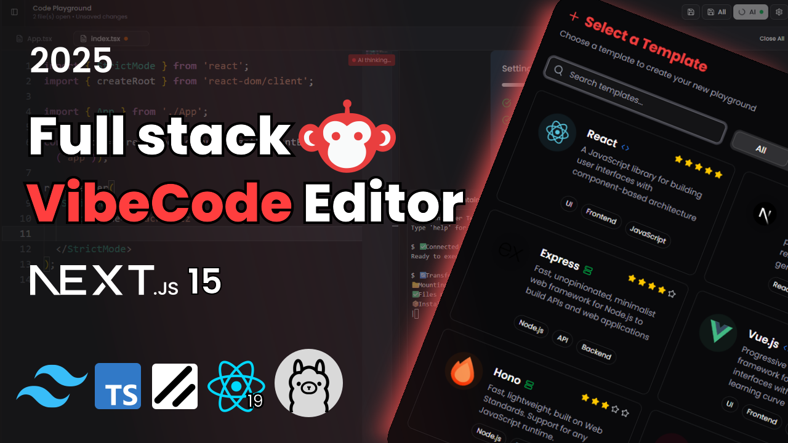
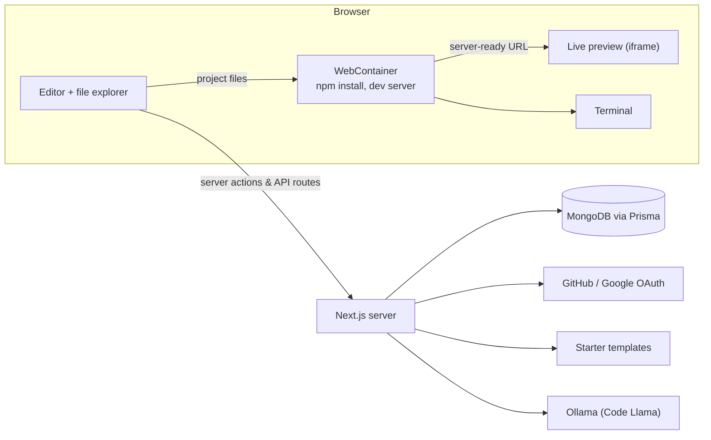

<div align="center">

# Vibe Code Editor

**A browser-based IDE: pick a starter template, write code, and see it run live, all inside the browser.**




</div>

---

## About

Setting up a project on your own machine takes time: installing Node.js, packages and tools before writing a single line of code. Vibe Code Editor removes that step.

Sign in, choose a template such as React or Express, and you get a full project with a file explorer, a VS Code-style editor and a terminal. The code runs **inside your browser** using [WebContainers](https://webcontainers.io), so you see a live preview without any server running your code. An AI assistant suggests code as you type and answers questions in a chat panel.

## Features

- **Sign in with GitHub or Google** (NextAuth)
- **Dashboard** to create, edit, duplicate, delete and star projects
- **6 starter templates:** React, Next.js, Express, Vue, Hono and Angular
- **File explorer** to create, rename and delete files and folders
- **Monaco editor** (the editor behind VS Code) with tabs, syntax highlighting, unsaved-change markers and `Ctrl+S` to save
- **Runs in the browser:** WebContainers install dependencies, start the dev server and show a live preview
- **Built-in terminal** (xterm.js) to run your own commands
- **AI code suggestions** shown as ghost text: `Tab` to accept, `Esc` to dismiss, `Ctrl+Space` to ask for one
- **AI chat assistant** with code blocks, tables and math rendering
- **Dark and light themes**

## How it works



1. **Template to file tree:** when a project is opened for the first time, the server reads the template folder recursively (skipping `node_modules`, lock files and large files) and turns it into a JSON tree of folders and files.
2. **Editing:** the tree is kept in a Zustand store. The explorer renders it, and files open as tabs in Monaco.
3. **Running:** the browser boots a WebContainer, mounts the files, runs `npm install` and the start script, and shows the dev server's URL in an iframe.
4. **Saving:** saved files are written into the WebContainer (so the preview updates) and the project tree is stored in MongoDB.
5. **AI:** the code around the cursor is sent to a local Code Llama model through Ollama. Suggestions appear as ghost text in the editor.

## Tech stack

| Area | Technology |
| --- | --- |
| Framework | Next.js (App Router), React, TypeScript |
| Styling | Tailwind CSS, shadcn/ui |
| Editor | Monaco Editor |
| In-browser runtime | WebContainer API |
| Terminal | xterm.js |
| State | Zustand |
| Database | MongoDB with Prisma ORM |
| Auth | NextAuth (Auth.js) with GitHub and Google OAuth |
| AI | Ollama running Code Llama |

## Getting started

### Prerequisites

- **Node.js 20.9 or newer**
- **A MongoDB database.** [MongoDB Atlas](https://www.mongodb.com/atlas) (free tier) works out of the box. Prisma needs MongoDB to run as a replica set, which Atlas already does.
- **GitHub and Google OAuth apps** for sign-in (see below)
- **[Ollama](https://ollama.com)** for the AI features (optional; the editor works without it)
- **Chrome or Edge** is recommended, since WebContainers work best in Chromium-based browsers


## Project structure

```
app/                    Pages and API routes (Next.js App Router)
├── (root)/             Home page
├── (auth)/             Sign-in page
├── dashboard/          Project dashboard
├── playground/[id]/    The editor
└── api/                auth, template/[id], code-completion, chat
modules/                Code grouped by feature
├── auth/               Sign-in UI, user helpers
├── dashboard/          Project list and server actions
├── playground/         Editor, file explorer, AI hooks, file-tree helpers
├── webcontainers/      WebContainer setup, preview, terminal
└── ai-chat/            AI chat panel
components/ui/          shadcn/ui components
lib/                    Prisma client, template paths, utilities
prisma/schema.prisma    Database models
vibecode-starters/      Starter templates
auth.ts, auth.config.ts NextAuth setup
middleware.ts           Protects pages that need sign-in
next.config.ts          COOP/COEP headers for WebContainers
```

## Notes

- **COOP and COEP headers:** WebContainers need `SharedArrayBuffer`, which browsers only allow on cross-origin isolated pages. `next.config.ts` sets `Cross-Origin-Opener-Policy: same-origin` and `Cross-Origin-Embedder-Policy: require-corp` for this.
- **Node.js projects only:** WebContainers run Node.js, so templates must be JavaScript or TypeScript projects.
- **AI runs locally:** suggestions and chat need Ollama running on the same machine as the app server.

## Roadmap

- Import and push projects from GitHub
- Hosted AI model with streaming responses
- Save individual files, auto-save and version history
- Real-time collaboration

## Acknowledgements

- Starter templates from [StackBlitz starters](https://github.com/stackblitz/starters) (MIT License)
- [WebContainer API](https://webcontainers.io) by StackBlitz
- [Monaco Editor](https://microsoft.github.io/monaco-editor/) by Microsoft
- [Ollama](https://ollama.com) and Code Llama by Meta

## Author

Built by [Aditya-321-prog](https://github.com/Aditya-321-prog).
